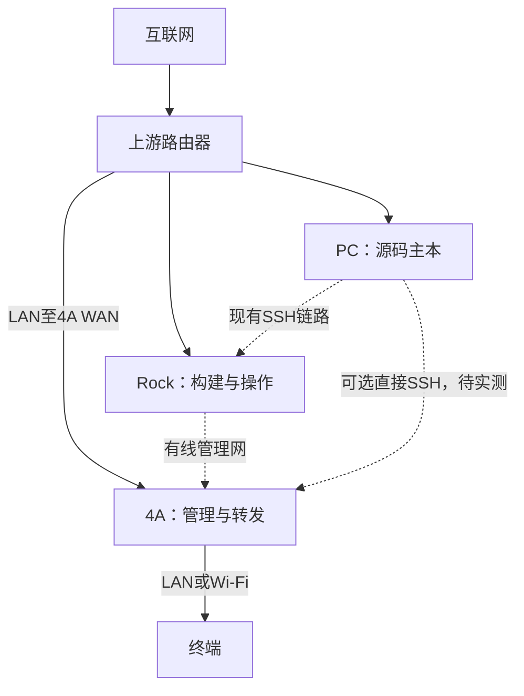

# 小米4A适配与基本拓扑

本文保存可公开的硬件与适配事实。当前固件身份、完成度和负载结果见[状态](../status.md)，实际访问目标与主机配置由[私有环境文件](../operations/environments.md)提供。

## 硬件和系统边界

| 项目 | 适配记录 |
| --- | --- |
| 型号 | 小米路由器4A千兆版，接口标识R4A |
| 修订核对 | 机身标签为千兆版／R4A；PCI无线为MT7662／MT7603，与第一版千兆OpenWrt目标对应；未拆机确认PCB |
| 目标 | `xiaomi_mi-router-4a-gigabit`，不能把V2或其他4A镜像直接替换使用 |
| 公开规格 | MT7621A，128MB DDR3，16MB NOR，2个千兆LAN、1个千兆WAN，双频无线，无USB |
| 原厂实测 | Linux3.10.14、16MiB Flash、Linux可见内存124,160KiB |
| 系统演进 | MiWiFi2.28.91→2.28.62→自编OpenWrt；具体执行见历史报告 |
| 首刷边界 | 原厂OS1为13MiB；构建限制13248KiB。它与OpenWrt固件区容量不可混算 |
| 管理约定 | 项目首启脚本使用非默认LAN地址、LAN内SSH122、公钥认证；Web开放前需配置认证 |

物理恢复写回未实测；字符串、分区备份和一次重启都不能证明恢复演练已通过。设备身份、分区及首刷证据见[原厂基线](../reports/2026-10-22-4a-baseline-and-route-validation.md)与[首刷](../reports/2026-10-23-first-flash-review.md)。

## 当前实验环境示例

本节为可选个人实验环境，不是项目所需的硬件清单；构建主机与设备访问方式可分别选择。4A构建参数保持独立。

Rock有线用于管理4A，默认上网与DNS走上游；4A的LAN管理网和上游网须分离。PC直连4A时也需核对虚拟网卡、无线、有线是否存在重叠网段；不能为了直接管理擅自修改PC默认路由或DNS。

最新记录中4A WAN与Rock所连LAN口均为1000Mbps全双工，这只是物理链路。Rock不承担生产代理或网页服务；物理断开Rock的完整验收尚待完成。

## 访问和维护

使用[环境与访问说明](../operations/access.md)选择经Rock或PC直接管理；SSH别名、地址、指纹文件、私钥路径、SSID和备份位置仅存私有资料。新增环境不自动修改SSH配置、已信任主机或网络设置。

保留配置升级前核对持久marker、认证和外置备份，不能重跑首启默认值覆盖已配置LAN／SSH／Web。部署与恢复前提分别见[部署](../operations/deployment.md)和[恢复](../operations/recovery.md)。

公开规格参考：[小米官方规格](https://www.mi.com/in/product/mi-router-4a-gigabit-edition/specs/)、[OpenWrt设备资料](https://openwrt.org/toh/hwdata/xiaomi/xiaomi_mi_router_4a_gbit)。这些链接是型号参考，不能替代本机修订和镜像核验。
