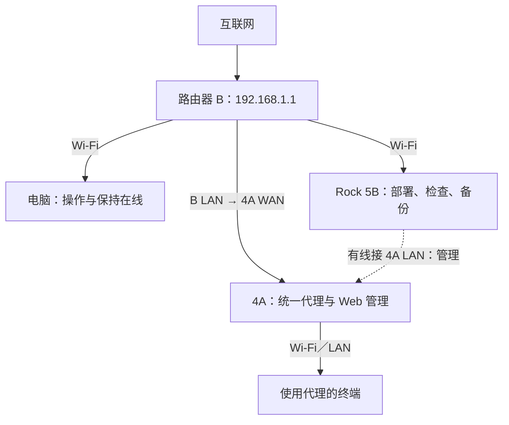

# AlwayRoute 实施路径与阶段方案

- 整理日期：2026-10-22（Asia/Shanghai）
- 状态：已取得 root／SSH，完成本轮在线备份、SSH 加固和一次重启验证；继续评估两条独立运行路线，尚未选定最终路径。
- 需求基线：[项目需求](requirements.md)。
- 实际设备与已发生的操作：[设备记录](devices/xiaomi-4a.md)。

## 1. 两条路径的共同结果

无论底层是否更换固件，都需要让用户通过独立、完整的 Web 入口管理代理节点、订阅和基本分流规则，查看状态及实时流量，并完成配置保存、应用和恢复。

不要求自研所有组件。优先调查开源项目能否覆盖需求；现成 Dashboard 的运行控制能力与持久节点编辑能力需要分别核实。

## 2. 路径 A：刷入适配的新固件

### 方案组成

- 核验本机硬件修订和闪存布局，选择适配的 OpenWrt 等固件。
- 已构建两种静态 sing-box 核心并完成原厂显式代理实测，正在原生构建 OpenWrt 验证镜像；完整镜像及轻量管理扩展的资源预算仍待核对，现成插件也须按相同标准筛选。
- 复用已满足要求的节点、订阅和规则管理能力；对缺口再评估 AlwayRoute 的界面与管理扩展。
- 通过路由器的转发和 DNS 机制接管终端流量。

### 预期收益与限制

- 可评估更完整的系统管理和软件集成环境，减少原厂固件接口的限制。
- 仍受 4A 的闪存、内存及处理能力限制，不能假定插件能够完整安装或稳定运行。
- 固件更换会影响原厂管理功能和无线实现，实际性能及兼容性需重新验收。
- 刷机存在管理断联和恢复需求，必须在具体型号确认、备份和恢复方案准备后另行决定。

### 进入实施的条件

1. 确认硬件修订、芯片、镜像类型和适配证据。
2. 准备可用备份，核对恢复方式及其所需条件。
3. 验证拟用固件、插件、核心和 Web 管理组合的资源预算。
4. 解决首次启动地址与路由器 B 的 `192.168.1.0/24` 网段冲突问题。
5. 形成具体文件、校验值、操作及回退清单后，再决定是否刷入。

## 3. 路径 B：保留小米固件并增加服务

### 方案组成

- 保留原厂系统及 Wi-Fi、WAN、LAN 等基础管理能力。
- 取得满足部署要求的系统权限，安装兼容的代理核心。
- 评估 ShellCrash 是否适合承担核心部署、启停、流量接管和启动维护等职责。
- 通过现成或必要的轻量扩展，提供 AlwayRoute 的完整配置管理服务和 Web 入口。
- 代理核心候选包括 Mihomo、sing-box；具体版本、架构、节点支持及面板兼容性待验证。

### 预期收益与限制

- 可以继续使用原厂基础网络管理，避免为了代理功能立即更换整个系统。
- 原厂管理后台的 PPTP／L2TP VPN 功能不能直接等同于 SS／VMess／VLESS／Trojan 节点执行能力。
- 当前固件为 2.28.62，root／SSH 已复核并通过一次重启自启验证；已有分区、空间、内存及防火墙采样，两种静态核心均完成单条 VMess 显式代理测试，独立持久化、透明接管和完整管理能力尚未验证。
- 取得 root 不等于一定能部署全部服务，ShellCrash 支持小米系统也不等于本机本版本已适配。
- 临时目录运行不等于长期独立部署；如果每次启动必须由 Rock 供给程序，应明确记录为外部依赖。

### 进入实施的条件

1. 当前版本存在经过核验、改动范围明确的权限获取方法。
2. 取得权限后读取架构、内核、分区、挂载、内存、空间、DNS 和转发组件信息。
3. 对安装目录、配置保存、启动行为和资源占用形成可执行方案。
4. 对新增的认证、服务、DNS、转发及启动配置，准备可以验证的撤销方法。

## 4. 比较与选择标准

| 维度 | 路径 A：新固件 | 路径 B：保留小米固件 |
| --- | --- | --- |
| 网页完整管理节点与规则 | 评估现成插件及缺口 | 评估现成组件与轻量管理扩展 |
| 当前前置条件 | 最终型号适配、恢复条件、实际镜像和刷入路径；已有在线备份 | 核心兼容、空间／内存、独立启动与完整配置管理；root／SSH 已通过 |
| 基础网络功能 | 由新固件提供，需重验无线和转发 | 保留原厂实现，需验证新增服务的影响 |
| 资源约束 | 镜像、插件、核心和运行内存一起核算 | 原厂系统之外的空间、内存和模块一起核算 |
| 维护重点 | 固件及插件升级、配置迁移 | 原厂升级影响、服务适配、配置保存及启动 |
| 当前选择状态 | 候选 | 候选 |

以实测是否满足需求决定路线，不以“已经能打开面板”或“已经拿到 root”作为部署成功判据。

## 5. 部署拓扑与管理保障

目标正常使用拓扑如下，不代表已核实当前全部物理接线：

- 当前管理网段为 4A 的 `192.168.31.0/24`；具体地址以实施时核验为准。
- 电脑通过 B 保持互联网访问；Rock 的默认路由和 DNS 走 B，有线用于访问 4A。
- 刷机或恢复可能改变 LAN 地址，需在操作前处理与 B 及电脑虚拟网卡的地址冲突。
- 用户已不采纳 Rock 长期网关方案；本计划保持 4A 独立运行目标。

## 6. 分阶段推进

用户已在当前对话授权按阶段推进；本轮通过已有 SSH 完成设备复核、在线备份、SSH 加固及一次重启验证，没有重跑早期已取消的漏洞验证。原厂核心最小兼容与 VMess 显式代理实测已完成，新固件继续离线构建及容量筛选。代理接管、长期部署和刷机仍须满足各阶段门槛，不能由 root 成功推出完整方案可行。自有源码、构建配方和补丁以电脑仓库为主，通过 rsync 同步到 Rock 独立工作副本，见[开发流程](development-workflow.md)。

当前直接证据见[本轮验证报告](reports/2026-10-22-4a-baseline-and-route-validation.md)。先前本地环境资料保留为历史筛选依据，其中“未取得 shell”的设备状态已被新证据更新；压缩实验仍不等于可刷镜像或吞吐达标。

后续执行顺序：共同准备（当前已完成 SSH／在线备份／一次重启，物理恢复未实测）→ 原厂核心最小实测与新固件离线预算 → 两条路线的管理功能缺口核对 → 路线选择 → 完整集成与独立运行验收。原厂试验先使用显式代理，随后才对单个测试终端接管，分别验证 TCP、DNS、UDP、IPv6 及撤销行为。新固件先取得实际产物、适配和恢复证据，再提交具体刷机文件与步骤。

| 阶段 | 主要任务 | 产物／继续条件 |
| --- | --- | --- |
| 1：需求与现成方案核对 | 整理已知混合协议的脱敏样本，核对关键功能与组件缺口 | 协议／参数清单、功能覆盖与缺口清单 |
| 2：两条路径可行性验证 | A 核算定制镜像及资源；B 调查原厂兼容、权限方式与持久化条件 | 实际构建与兼容性证据；未取得的实机数据明确留空，不以估算代替 |
| 3：路线与组件决定 | 比较完整功能、资源、稳定性和维护成本 | 选定路线、固定组件版本、具体部署清单 |
| 4：管理能力实现 | 节点／订阅／规则数据、网页、校验、应用及恢复 | 在开发环境完成完整操作流程，再对接设备 |
| 5：设备联调 | 单节点与单设备起步，验证透明转发、分流、DNS、状态和流量 | 网页结果与实际流量一致，失败可恢复 |
| 6：持久化与验收 | 启动恢复、订阅更新、资源及实际使用验证 | 通过需求文档的首版验收，记录限制与维护方法 |

界面及管理流程可以用模拟执行模块先验证，但模拟成功不能替代设备兼容、透明转发或实际出口验证。

### 分工与依赖

默认由单个主 Agent 负责资料核验、实现整合、设备操作、验证与记录。设备权限、安装、网络和启动配置相互依赖，对同一台路由器的写入按顺序执行，避免多个操作互相干扰。

用户负责提供不含敏感凭证的协议信息、必要的物理接线配合和终端使用反馈。独立的资料整理与界面设计可在条件允许时并行；当前方案不预设需要 Sub-Agent。

## 7. 当前验证结论与早期取消记录

本轮已直接验证：原厂 2.28.62 的 root 密钥登录、LAN 限定且仅公钥认证的 SSH、默认系统 root 密码更换、完整在线分区备份、一次重启后的自启与基础 HTTPS 上网，以及两种静态 sing-box 构建的单条 VMess 显式代理。Rock 路由和 DNS 未改变。用户确认机身标签“千兆版、R4A”，硬件 PCI 为 MT7662／MT7603，与第一版千兆 OpenWrt 目标对应；实际恢复仍待核验。用户另行批准了任务目录内的 Go 1.27.3 ARM64 工具链、缓存，以及 5 项系统构建依赖和最多约 30GB 的 OpenWrt 原生构建范围；最终镜像仍在构建，尚未刷机。

以下为此前文档阶段的历史快照，不代表当前设备仍无 root 或仍为 2.28.91：

截至 2026-10-22：

- 已完成公开发布物尺寸、压缩参考量与源码初查；尚无满足完整需求的达标构建，RAM、吞吐和启动恢复均未在 4A 上验证。
- 本机公开接口返回 `R4A`、MiWiFi `2.28.91`、`CN`。
- 尚未取得 4A root／SSH；未安装代理服务、未降级或刷机。
- 已授权完成 Rock 的管理网络调整，并验证其上网和 SSH 通道。
- 曾通过 Rock 使用固定提交 `16a46e350e3de2cb3415ab2cb652df53783998dc` 的 XMiR-Patcher 尝试连接。
- 首个上传包返回 HTTP 200、业务码 `1629`，包装脚本立即停止，剩余包及测速触发未执行。
- 后续源码核对发现，旧版上传实现可能先解包再因缺少备份文件返回 `1629`；故该码不能单独证明载荷未落地或完整利用链失效。
- 原版 SSH 载荷包含 root 密码、NVRAM 和启动脚本等改动，不能称为完全无持久改动的临时操作。
- 用户曾提出最小载荷／root 命令验证，随后明确取消；该验证未执行。当前任务仅整理项目文档。

权限获取的详细状态以设备记录为准。文档中列出下一步候选，不代表继续执行已取消的验证。

## 8. 调研参考

- [ShellCrash 官方项目](https://github.com/juewuy/ShellCrash)：候选部署与运行组件。
- [Mihomo 官方 API](https://wiki.metacubex.one/api/)：候选运行控制、连接与流量接口。
- [OpenClash 官方项目](https://github.com/vernesong/OpenClash)：新固件路线的候选管理组件。
- [XMiR-Patcher 已审查的连接代码](https://github.com/openwrt-xiaomi/xmir-patcher/blob/16a46e350e3de2cb3415ab2cb652df53783998dc/connect1.py)。
- [原始测速漏洞研究中的上传处理逻辑](https://github.com/UltramanGaia/Xiaomi_Mi_WiFi_R3G_Vulnerability_POC/blob/207f4cbc6e6cb0220d36f45cb8f2682efb8b5727/report/report.md#L211)。

这些资料用于说明候选组件和技术背景，不构成对本机当前版本的适配或成功证明。正式实施前须重新核验具体版本及其实际改动。
