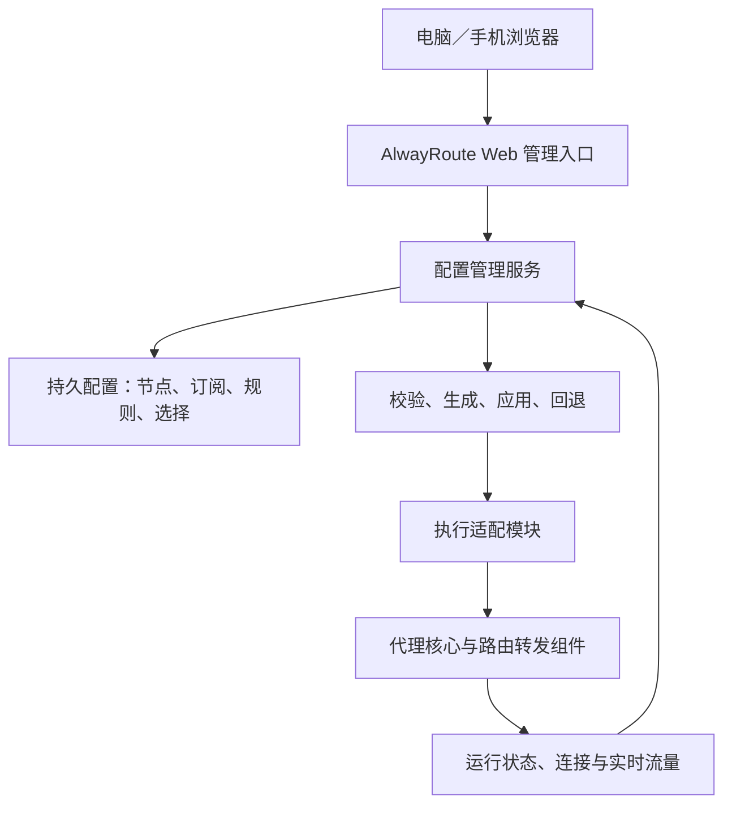

# AlwayRoute 项目需求

- 更新日期：2026-10-23（Asia/Shanghai）
- 状态：自编OpenWrt主线；本文件定义需求，已实现范围与验收进度统一见[当前状态](status.md)。
- 配套文档：[实施方案](implementation-plan.md)、[设备记录](devices/xiaomi-4a.md)。

## 1. 产品目标

在小米路由器 4A 上提供统一的代理转发能力，以及可通过浏览器访问的节点和规则管理系统。连接 4A 的终端正常使用该路由器作为网关，即可按配置使用代理，无需逐台配置客户端。

AlwayRoute 的交付包括完整的网页管理及配置应用能力。仅把一个节点运行起来，或只提供查看和切换现有节点的面板，均不足以满足需求。

## 2. 用户与使用方式

- 管理者通过局域网内的电脑或手机浏览器访问 AlwayRoute。
- 在网页中维护节点、订阅和规则，启停代理、切换线路并查看状态。
- 其他终端连接 4A 的 Wi-Fi 或 LAN，按路由器的统一策略访问网络。
- 保留管理通道，使代理故障时仍可进入管理界面检查或恢复配置。

协议需求包含VMess，以及后续待逐项支持的Hysteria2、VLESS Reality／Vision、Trojan和SS。当前界面建模与订阅导入范围以状态及契约为准，不能由核心编译标签推导完整支持，也不能将这些节点等同于小米原生PPTP／L2TP VPN配置。

## 3. 实施范围与约束

1. 当前实施主线为自编 OpenWrt；原厂固件加装服务保留为历史备选与恢复资料。
2. 以功能、稳定性、资源占用和维护成本验收，不能由基础固件首刷成功推出完整产品通过。
3. 优先使用现有硬件，当前主要目标是由 4A 独立提供转发与 Web 管理。
4. Rock 5B负责构建、操作、下载、检查和备份。用户已明确不采用长期依赖 Rock 承载管理或转发的方案。
5. 先评估现成开源项目及组合，按实际功能缺口决定是否开发扩展。
6. 原始设备基线为 MiWiFi 2.28.91，随后降级 2.28.62 并取得 root；当前已获单独批准刷入自编 OpenWrt 25.12.6，详见设备记录。文档本身不构成新增安装或刷机授权；实际操作遵守对话中的具体授权范围。

## 4. 功能需求

### 4.1 独立 Web 管理入口

- 提供统一的 AlwayRoute 入口，覆盖节点、订阅、规则、状态和系统恢复。
- 适合电脑和手机浏览器，重要操作的结果和失败原因可见。
- 可复用满足要求的开源界面或插件；需要定制时，以完整的配置管理流程为准。
- 自编OpenWrt复用LuCI负责Wi-Fi、WAN和LAN等基础配置；代理管理与系统认证、权限一致。
- 提供管理认证，管理接口默认仅向受控局域网开放；敏感字段不出现在普通日志中。

### 4.2 节点管理

- 支持手动添加、编辑、删除、启用和停用节点。
- 支持从首版明确支持的节点链接／配置格式导入；不支持的协议或参数应明确提示。
- 展示节点名称、协议、来源、可用性检查结果及当前选择。
- 支持单节点及整个订阅的连通性／延迟检查；默认串行，显示进度并可取消，保留已完成结果，不自动切换节点。检测期间保持正常代理转发，避免持续并发测速及大流量带宽测试。
- 支持一键选择和切换，并显示实际生效结果。
- 节点采用稳定标识，改名后不应导致规则引用失效。
- 删除被规则引用或正在使用的节点时，明确处理引用及替代出口。

### 4.3 订阅管理

- 支持添加、编辑、停用和删除订阅来源，手动更新及可配置的定时更新。
- 显示最后更新结果、时间和错误原因。
- 订阅更新失败或内容无效时，保留最后一份可用数据。
- 区分手动节点与订阅节点，保留来源信息。
- 订阅节点的本地重命名、参数修改和排除，应保存为独立覆盖设置，避免下次更新直接覆盖用户操作。
- 更新导致已选节点消失或规则引用失效时，按明确策略处理并报告结果。
- 具体订阅格式和是否需要转换组件，在真实输入确认后确定；不默认将带凭证的订阅发送给公共转换服务。

### 4.4 规则与智能分流

- 支持规则模式、全局代理和直连等明确的运行模式，具体能力以选定执行组件为准。
- 首版支持基本域名、IP／网段规则及默认出口设置。
- 支持指定规则使用直连、代理节点／策略组或阻断等已支持动作。
- 规则优先级、默认行为和冲突处理应明确，并可持久保存。
- DNS、IPv6 和 UDP 的处理必须与所声明的代理范围一致；无法支持的范围应明确展示。
- 按设备策略、自动选优和自动故障切换作为扩展项，依据实际需求及资源验证决定。
- 用户已选择节点故障时阻断本应代理的流量，不自动回退直连；核心整体故障时当前实现会扩大阻断到公网 direct 规则，属于明确的首版限制。

### 4.5 状态与流量监控

- 区分服务是否运行、配置是否加载成功、节点检查是否通过和实际连接使用哪个出口。
- 展示当前线路、运行模式、实时上下行速率与适量的错误日志。
- 执行组件支持时，展示当前连接、命中规则及所用节点，并允许关闭指定连接。
- 实时流量属于首版范围；按设备累计流量、按天历史统计与长期存储属于后续评估项，不能以实时图表代替。
- 限制日志、连接列表、轮询和统计缓存的开销，避免占满设备资源。

### 4.6 配置保存、应用与恢复

- 节点、订阅、规则和选择状态应持久保存，重启后可恢复。
- 网页区分“已保存”“已应用”和“连通性检查通过”，不能仅以请求成功表示代理正常。
- 配置变更经过校验和生成后再应用；加载失败时恢复上一份可用配置。
- 更新订阅、编辑节点和切换配置应协调执行，避免多个操作互相覆盖。
- 默认切换目标为后续新连接；已有连接的行为以执行组件为准，界面提供必要说明或关闭旧连接操作。
- 提供代理服务启停、配置导出和上一份可用配置恢复。
- 可撤销由本项目增加的 DNS、转发与启动配置，恢复可管理的基础联网状态；恢复能力须实测，不能简单等同于重启或恢复出厂设置。

## 5. 逻辑架构

以上是逻辑职责，不要求每一层都开发独立程序。新固件上的现成插件，或原厂固件上的合适组件，可以承担其中多项职责。

管理配置与实际转发应有明确的负责组件；源模型由管理后端维护、运行配置由生成器产生，避免网页、命令行和定时更新同时覆盖文件。

## 6. 首版验收标准

| 编号 | 验收项 |
| --- | --- |
| A1 | 浏览器可登录管理界面，完成手动节点增删改，并验证刷新和重启后的保存结果。 |
| A2 | 可添加真实订阅、更新并查看结果；失败时原数据可用，本地覆盖及排除不被更新冲掉。 |
| A3 | 网页切换线路后，使用新连接验证实际出口，界面显示与实际一致。 |
| A4 | 测试终端正常连接 4A 即可按规则使用代理，无需手动配置代理客户端。 |
| A5 | 基本分流规则及 DNS 行为符合设置；IPv6、UDP 的支持范围有实测结果或明确限制。 |
| A6 | 可查看服务、节点检查结果与实时流量，不把进程存活当作节点可用。 |
| A7 | 无效配置或订阅更新失败不会丢失上一份可用配置；可恢复基础联网和管理访问。 |
| A8 | 重启 4A 后服务及配置按预期恢复；断开 Rock 也能管理和转发。 |
| A9 | 正常使用中无反复内存不足、进程退出或明显无线异常，资源余量和实际吞吐有记录。 |

## 7. 尚待决定

- 自编固件完整功能组合的空间、运行和性能边界；基础候选适配及启动已实测。
- 已知混合协议的参数兼容范围、订阅格式与脱敏测试样本。
- 约200Mbps代理目标需要分别记录直连／无线／代理吞吐及实际并发负载；达标状态见当前状态，不能把千兆物理接口当作性能保证。
- 用户已选择：本应代理的流量在节点不可用时阻断，不自动回退直连；IPv6、UDP 的首版范围仍须实测。
- 是否需要按设备策略与长期历史流量统计。
- 若独立路线未通过资源或性能验证，记录具体失败条件，再讨论取舍；不自动改为依赖 Rock。

这些未决事项不改变已确认的核心需求：网页完整管理节点、订阅和基本规则，并将配置实际应用到路由器转发。
